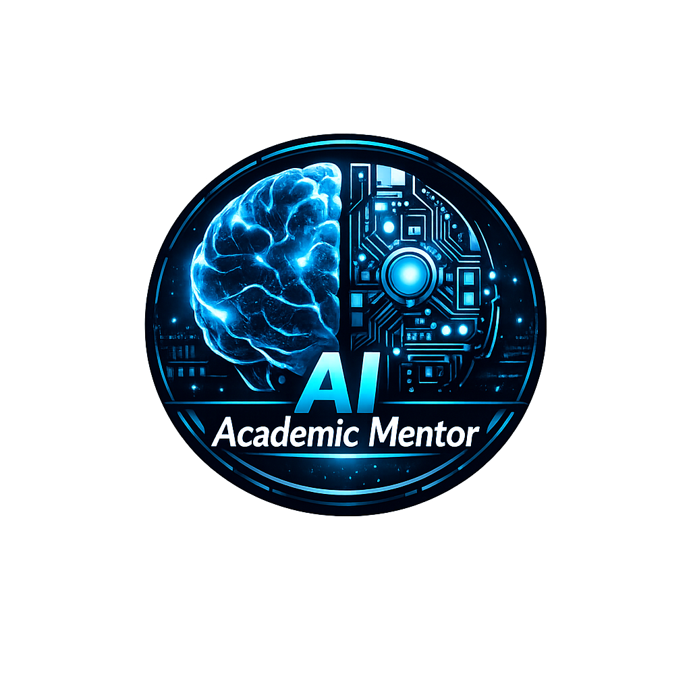

> **Course:** CSE 4104 | **Semester:** Spring 2026 | Northern University of Business & Technology, Khulna
<p align="center" style="margin-bottom:-15px;">
  
</p>

<div align="center">

# 🧠 **AI Academic Mentor**
### Personalized Learning Assistant for Students

### 🚀 **[🌐 VISIT LIVE WEBSITE →](https://cse4104-7c-t05-ai-academic-mentor.vercel.app/)**
---

<p align="center">
  
  
  
  
  
  
  
  
  
  
  
</p>


</div>

---

> **Course:** CSE 4104 – Software Development III | **Semester:** Spring 2026
> **Institution:** Northern University of Business & Technology, Khulna

---

## 📖 About the Project

**AI Academic Mentor** is a full-stack, AI-powered personalized learning assistant built to help university students study smarter. It combines the power of Google Gemini and Hugging Face AI models with a modern React frontend and a robust Node.js/Express backend to deliver a complete academic companion.

The system solves real-world student problems such as unstructured study schedules, generic learning materials, lack of instant academic Q&A, and no feedback on strengths/weaknesses.

---

## 🎯 Problem Statement

Students struggle with:
- 📅 Unstructured study schedules
- 📚 Generic materials not adapting to individual pace
- ❓ No instant academic Q&A
- 📊 Lack of feedback on strengths/weaknesses

## 💡 Our Solution

**AI Academic Mentor** delivers a full-stack intelligent assistant with:
- 💬 AI Chatbot
- 📝 Quiz Generator
- 📅 Study Planner
- 📄 Note Summarizer
- 📊 Progress Dashboard

---

## ✨ Features

| # | Feature | Description |
|---|---------|-------------|
| 🔐 | User Authentication | Secure JWT login/logout with bcrypt password hashing |
| 💬 | AI Chatbot | Real-time academic Q&A via Google Gemini |
| 📝 | Quiz Generator | MCQ quizzes + score history tracking |
| 📅 | Study Planner | Day-by-day personalized schedules |
| 📄 | Note Summarizer | Multiple summary styles |
| 🗒️ | Personal Notes | Store and manage notes separately |
| 📊 | Progress Dashboard | Aggregated performance stats |
| 🛡️ | Admin Dashboard | Real user activity monitoring |

---

## 👥 Team Information

| Field | Details |
|-------|---------|
| **Team** | CSE4104-7C-T05 |
| **Section** | 7C |
| **Instructor** | Md. Riaz Mahmud, Assistant Professor, Dept. of CSE, NUBTK |

### 👨‍💻 Team Members

| 🏅 Role | 👤 Name | 🎓 Student ID |
|---------|---------|---------------|
| ⭐ Team Leader | Shadman Sadequeen Priyo | 11230121158 |
| 🎨 Frontend Developer | Musabbir Hossain Chayon | 11230121168 |
| ⚙️ Backend Developer | Sk. Nadirul Haque Nadir | 11230121155 |
| 🤖 AI Integration Lead | Shafin Kabir | 11230121175 |

---

## 🛠️ Technology Stack

### Frontend
| Technology | Purpose |
|------------|---------|
| ⚛️ React.js 19 | User Interface development |
| ⚡ Vite 8 | Frontend build tool and dev server |
| 🛣️ React Router DOM | Client-side routing |
| 🌐 Axios | API calls and HTTP requests |
| 🎨 CSS3 | Styling and responsive design |
| 📜 JavaScript (ES6+) | Frontend application logic |

### Backend
| Technology | Purpose |
|------------|---------|
| 🟢 Node.js | JavaScript runtime environment |
| 🚏 Express.js | REST API framework |
| 🔑 JSON Web Token (JWT) | Authentication and authorization |
| 🔒 bcryptjs | Password hashing and security |
| 🌍 CORS | Cross-Origin Resource Sharing |
| ⚙️ dotenv | Environment variable management |
| 🛡️ Helmet | HTTP security middleware |
| 📑 Morgan | HTTP request logging |
| ⏱️ Express Rate Limit | API rate limiting and security |

### Database
| Technology | Purpose |
|------------|---------|
| 🍃 MongoDB | Primary NoSQL database |
| 🔗 Mongoose | ODM for database operations |

### AI Integration
| Technology | Purpose |
|------------|---------|
| 🌐 Google Gemini API | Primary AI engine for chatbot, quiz generation, study planner, and summarization |
| 🤗 Hugging Face Inference API | Backup AI model for inference and content generation |

### Deployment
| Technology | Purpose |
|------------|---------|
| ▲ Vercel | Frontend hosting |
| 🟩 Render | Backend hosting |
| ☁️ MongoDB Atlas | Cloud database hosting |

---

## 🌐 Live Demo

### 🚀 **[https://cse4104-7c-t05-ai-academic-mentor.vercel.app/](https://cse4104-7c-t05-ai-academic-mentor.vercel.app/)**

> Click the link above to try the live application. Register an account and explore all AI features!

---

## 🚀 Getting Started (Local Setup)

### 📋 Prerequisites

| Tool | Version | Purpose |
|------|---------|---------|
| 🟢 Node.js | v18+ | JavaScript runtime |
| 📦 npm | v9+ | Package manager |
| 🍃 MongoDB | v6+ | NoSQL database |
| 🔧 Git | Latest | Version control |
| 💻 Visual Studio Code | Latest | Source code editor |

### Installation Steps

```bash
# 1. Clone the repository
git clone https://github.com/Priyo-1158/cse4104-7c-t05-ai-academic-mentor.git

# 2. Navigate to project
cd cse4104-7c-t05-ai-academic-mentor

# 3. Install Backend Dependencies
cd backend
npm install

# 4. Create .env file (copy from .env.example)
cp .env.example .env
# Then edit .env with your MongoDB URI, JWT secret, and API keys

# 5. Run Backend Server
npm start

# 6. Install Frontend Dependencies (open a new terminal)
cd ../frontend
npm install

# 7. Run Frontend App
npm run dev
```

### 🔐 Environment Variables

Create a `.env` file inside `backend/` with the following:

```env
PORT=5000
NODE_ENV=development
MONGO_URI=your_mongodb_connection_string
JWT_SECRET=your_jwt_secret_key
GEMINI_API_KEY=your_gemini_api_key
HUGGINGFACE_API_KEY=your_huggingface_api_key
```

> ⚠️ Never commit your `.env` file to GitHub.

---

## 📁 Project Structure

```
cse4104-7c-t05-ai-academic-mentor/
│
├── backend/               # Node.js API (Week 6)
│   ├── middleware/
│   ├── models/
│   ├── routes/
│   ├── utils/
│   ├── .env.example
│   └── server.js
│
├── frontend/              # React app (Week 7)
│   ├── public/
│   ├── src/
│   └── package.json
│
├── test/                  # Test Cases (Week 10)
│   ├── test-cases.md
│   └── bug-report.md
│
├── diagrams/              # System diagrams (Week 4)
│
├── documentation/         # Project documents (PDFs)
│
├── screenshots/           # Frontend images
│
├── assets/                # Logo & static assets
│
├── .gitignore
├── LICENSE
└── README.md
```

---

## 📊 Project Progress (All 14 Weeks Completed)

| Week | Milestone | Status |
|------|-----------|--------|
| 1 | Team Formation & Idea Selection | ✅ Done |
| 2 | Project Proposal | ✅ Done |
| 3 | SRS Preparation | ✅ Done |
| 4 | System Design (Architecture, ERD, Use Case) | ✅ Done |
| 5 | UI/UX Design (Wireframes) | ✅ Done |
| 6 | Backend Development | ✅ Done |
| 7 | Frontend Development | ✅ Done |
| 8 | AI Integration | ✅ Done |
| 9 | Feature Completion | ✅ Done |
| 10 | Testing & Debugging | ✅ Done |
| 11 | Deployment & Security | ✅ Done |
| 12 | Final Report & User Manual | ✅ Done |
| 13 | Presentation Preparation | ✅ Done |
| 14 | Final Presentation & Viva | ✅ Done |

---

## 🧪 Testing Summary (Week 10)

### ✅ Deliverables Completed

| # | Deliverable | Status |
|---|-------------|--------|
| 1 | Functional Testing | ✅ Done |
| 2 | Authentication & Authorization Testing | ✅ Done |
| 3 | API Testing (Postman) | ✅ Done |
| 4 | Database Testing | ✅ Done |
| 5 | AI Feature Testing | ✅ Done |
| 6 | UI/UX Testing | ✅ Done |
| 7 | Responsive Testing | ✅ Done |
| 8 | Security Testing | ✅ Done |
| 9 | Bug Tracking & Fixing | ✅ Done |
| 10 | Regression Testing | ✅ Done |

### 📝 Sample Test Cases

| TC ID | Feature | Scenario | Expected Result | Status |
|-------|---------|----------|-----------------|--------|
| TC-01 | User Login | Valid credentials | Redirect to dashboard | ✅ Passed |
| TC-02 | User Login | Invalid password | Show error message | ✅ Passed |
| TC-03 | User Registration | Valid data | Create account | ✅ Passed |
| TC-04 | User Registration | Duplicate email | Show error message | ✅ Passed |
| TC-05 | AI Chatbot | Valid question | AI response | ✅ Passed |
| TC-06 | AI Chatbot | Empty input | Show validation error | ✅ Passed |
| TC-07 | Quiz Generator | Valid topic | Generate quiz | ✅ Passed |
| TC-08 | Note Summarizer | Valid notes | Generate summary | ✅ Passed |
| TC-09 | Protected Route | No token | Redirect to login | ✅ Passed |
| TC-10 | Mobile View | All pages | Responsive layout | ✅ Passed |

### 🐞 Bug Report Summary

| Bug ID | Description | Module | Severity | Status |
|--------|-------------|--------|----------|--------|
| BUG-01 | Login button disabled on empty fields | Authentication | Medium | ✅ Fixed |
| BUG-02 | AI response timeout for long questions | AI | Medium | ✅ Fixed |
| BUG-03 | Mobile navigation overlaps | Frontend | Low | ✅ Fixed |
| BUG-04 | Quiz score not saving correctly | Database | High | ✅ Fixed |

---

## 📄 Documentation

| Document | Location |
|----------|----------|
| Frontend Progress Report | [`documentation/`](./documentation) |
| Final Report | [`documentation/`](./documentation) |
| User Manual | [`documentation/`](./documentation) |
| API Documentation | [`documentation/`](./documentation) |

---

## 🤝 GitHub Workflow

- **Main Branch:** `main` (production-ready)
- **Development Branch:** `development`
- **Feature Branches:** `frontend`, `backend`, `ai-integration`


---

## 📌 Key Learnings

- Full-stack development with React + Node.js + MongoDB
- Real-world AI API integration (Gemini, Hugging Face)
- Production deployment on Vercel and Render
- Agile weekly development workflow
- Professional GitHub collaboration
- Security best practices (JWT, bcrypt, Helmet, rate limiting)

---

## 👨‍🏫 Instructor

**Md. Riaz Mahmud**  
*Assistant Professor*  
Department of Computer Science and Engineering  
Northern University of Business and Technology, Khulna

---

## 📄 License  

📜 **MIT License** ( Declared in `backend/package.json`)  
🕒 **Last Updated:** October 23, 2026  


